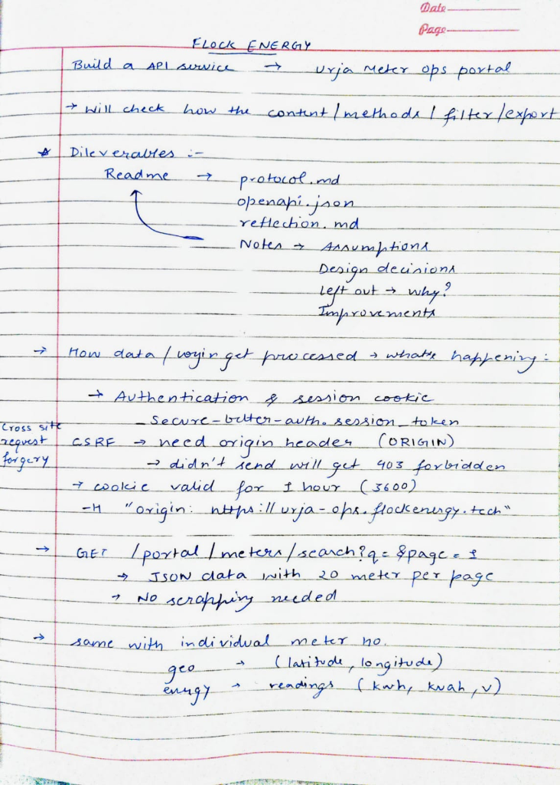

# Urja Meter Ops API Service

A clean, typed REST API service built with **Node.js**, **TypeScript**, and **Fastify** that sits in front of the legacy Urja Meter Ops web portal (`https://urja-ops.flockenergy.tech`). It exposes structured smart-meter information, geographic locations, network hierarchy, and 30-minute interval energy consumption without requiring downstream clients to interact with the legacy portal.

## Documentation Links
* [PROTOCOL.md](./PROTOCOL.md) — Reverse-engineering write-up of the portal (auth, endpoints, HMAC export, quirks).
* [REFLECTION.md](./REFLECTION.md) — 5 retrospective answers on assumptions, obstacles, and trade-offs.
* **OpenAPI 3.0 Specification**: `./openapi.json` (interactive Swagger UI served live at `http://localhost:3000/docs`).

---

## Project Structure
```text
.
├── src/
│   ├── client/       # Legacy portal HTTP client (session management, caching, 401 retry)
│   ├── normalizers/  # Data transformation functions (IST to UTC, strict number/date parsing)
│   ├── routes/       # Fastify REST route handlers
│   ├── types/        # Zod schemas & TypeScript definitions
│   ├── config.ts     # Zod-validated environment config with dependency injection
│   └── server.ts     # Fastify app, Swagger UI registration & error envelope
├── scripts/          # Standalone build & tooling scripts (generate-openapi.ts)
├── tests/            # Vitest unit and integration tests (19 passing 100% offline)
├── fixtures/         # Sanitized offline JSON responses from legacy portal sandbox
├── docs/             # Investigation notes and project assets
├── PROTOCOL.md       # Technical portal analysis
├── REFLECTION.md     # Answers to evaluation questions
└── openapi.json      # Generated OpenAPI 3.0 specification
```

---

## Quick Start

### 1. Configure Environment
```bash
cp .env.example .env
```
Ensure credentials are set in `.env`:
```env
PORT=3000
PORTAL_BASE_URL=https://urja-ops.flockenergy.tech
PORTAL_USERNAME=your_username_here
PORTAL_PASSWORD=your_password_here
```

### 2. Install & Run
```bash
npm install
npm run dev
```

### 3. Run Tests
The test suite runs **100% offline** with zero external network access and requires no `.env` file or portal credentials:
```bash
npm test
```

---

## Sample Requests

```bash
# 1. Health check
curl -X GET http://localhost:3000/health

# 2. List smart meters (paginated search)
curl -X GET "http://localhost:3000/v1/meters?page=1"

# 3. Filter meters by query
curl -X GET "http://localhost:3000/v1/meters?q=J100000"

# 4. Get meter details, GPS coordinates & 7-tier network hierarchy
curl -X GET http://localhost:3000/v1/meters/J100000

# 5. Get recent 30-minute interval consumption readings (kWh, kVAh, Volts)
curl -X GET "http://localhost:3000/v1/meters/J100000/consumption?limit=10"

# 6. Filter consumption with strict ISO dates
curl -X GET "http://localhost:3000/v1/meters/J100000/consumption?since=2026-06-20T00:00:00Z&until=2026-06-23T23:59:59Z"

# 7. Interactive Swagger documentation
# Open http://localhost:3000/docs in your browser
```

---

## Key Learnings

1. **HTTP Probing with `curl`**: Learned to use `curl` as a headless browser to inspect low-level transport details (`-i` for raw response headers, `-c` / `-b` for cookie jars, and `-H` for custom headers).
2. **SvelteKit CSRF Protection**: Discovered that SvelteKit validates the `Origin` header on form submissions. Omitting it caused `403 Forbidden: Cross-site POST form submissions are forbidden`. Adding `Origin: https://urja-ops.flockenergy.tech` resolved it.
3. **Session Cookies vs Tokens**: The portal uses Better-Auth setting an `HttpOnly` cookie (`__Secure-better-auth.session_token`) with a 1-hour lifetime (`Max-Age=3600`).
4. **JS Inspection over HTML Scraping**: Instead of fragile DOM scraping, reading the frontend JavaScript bundles (`5.C4dYcCRt.js`, `4.2Bgc2kUI.js`) revealed native JSON endpoints (`/portal/meters/search`, `/geo`, `/energy`) and a hidden HMAC-SHA256 bulk export endpoint.
5. **Session Resilience & Mutex**: An on-demand 401 retry interceptor handles unexpected upstream server reboots, while an in-flight promise mutex ensures concurrent requests share a single re-login rather than causing a stampede.

<details>
  <summary><b>notes</b></summary>
  <br/>

  | HTTP & Curl Probing | Deliverables & Investigation Flow |
  | :---: | :---: |
  |  |  |
</details>

---

## Notes

### Assumptions
* **Timezone**: The portal operates meters in Rajasthan, India (Jaipur Zone, Malviya Nagar). Energy timestamps arrive in local Indian format (`DD/MM/YYYY HH:mm`) without a timezone indicator. We strictly validate Gregorian calendar dates and convert all timestamps from **Indian Standard Time (IST = UTC+05:30)** to ISO-8601 UTC.
* **Cumulative Register Counters**: The `kwh` values continuously increase over time; they represent cumulative meter register readings (odometer-style), sampled approximately every 30 minutes, rather than interval delta usage.
* **Data Domain Integrity**: A reading of `0 kWh` is a valid physical measurement indicating an idle or inactive meter. Corrupt or unparseable upstream strings are preserved as `null` or rejected rather than coerced into `0`.
* **Read-Only Invariant**: The meter and telemetry endpoints strictly perform read-only queries. Authentication performs session generation via POST without mutating metering assets.
* **Session Lifecycle**: The legacy portal issues an auth cookie with `Max-Age=3600` (1 hour). We assumed sessions can expire or be invalidated at any time, requiring reactive re-authentication and recovery from SvelteKit HTML login redirects.

### Design Decisions & Trade-offs

#### 1. Fastify + Zod over Express
* Chosen for native type inference and schema validation via `fastify-type-provider-zod` and `@fastify/swagger`.
* **Benefit**: Validates query parameters and response payloads at runtime and automatically generates the OpenAPI 3.0 specification (`/openapi.json` and `/docs`) directly from code, eliminating documentation drift.

#### 2. In-Memory TTL Caching & Request Coalescing
* Querying `/v1/meters/:id` leverages the HMAC bulk export endpoint. To prevent upstream amplification from repeated requests or nonexistent IDs, the client implements a 5-minute in-memory TTL cache and an in-flight promise mutex. Concurrent requests share a single upstream export download.

#### 3. Reactive Session Interceptor with Mutex
* Instead of a rigid timer, the client catches 401s or HTML login redirects, triggers a synchronized re-login using an in-flight promise (preventing race conditions across concurrent callers), and replays the original request.
* Replayed HMAC export requests re-fetch signing keys and generate fresh timestamps and signatures.

#### 4. Decoupled OpenAPI Generation
* Build artifacts are separated from server boot. `openapi.json` is generated via `npm run generate:openapi` rather than writing to disk inside `app.listen()`, ensuring the server runs smoothly in read-only container filesystems (e.g. AWS Lambda / Docker).

#### 5. Deployment Trust Boundary
* This service is designed as an internal evaluation microservice. For public production exposure, edge rate limiting and caller authentication should be enforced at the gateway boundary.

### Fixture Provenance
The fixtures in `fixtures/` are sanitized JSON payloads captured from the evaluation sandbox environment, allowing complete, deterministic offline testing without exposing live operational credentials.
